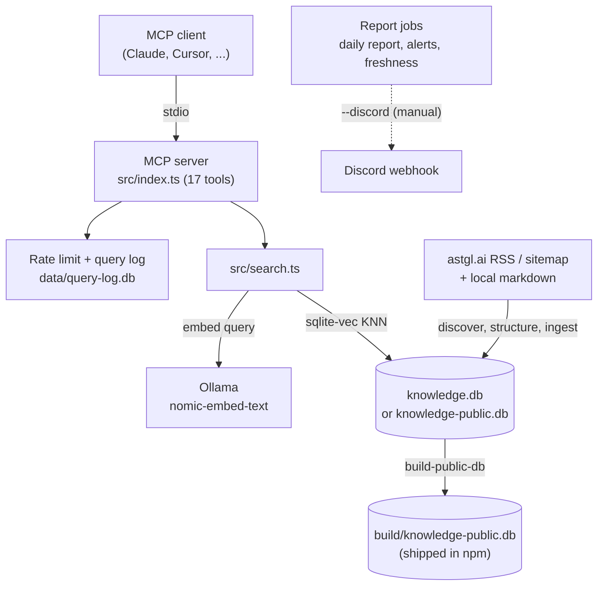

# mcp-astgl-knowledge

An MCP server that lets AI assistants search and cite content from [As The Geek Learns](https://astgl.ai) — covering MCP servers, local AI, AI automation, and ASTGL project documentation.

When an AI assistant connects to this server, it can search the indexed ASTGL entries (articles, tutorials, comparisons, guides, and project docs). Search results include source URLs back to astgl.ai.

> **Requirement:** the semantic tools (`search_articles`, `get_answer`, `get_tutorial`, `compare_topics`) embed your query at runtime with a local [Ollama](https://ollama.com) running `nomic-embed-text` (default `http://localhost:11434`). The metadata tools (`find_articles`, `list_tags`, `list_topics`, `get_latest`) work without Ollama.

## Quick Start

### Claude Desktop

Add to your `claude_desktop_config.json`:

```json
{
  "mcpServers": {
    "astgl-knowledge": {
      "command": "npx",
      "args": ["-y", "mcp-astgl-knowledge"]
    }
  }
}
```

### Claude Code

Add to your project's `.mcp.json`:

```json
{
  "mcpServers": {
    "astgl-knowledge": {
      "command": "npx",
      "args": ["-y", "mcp-astgl-knowledge"]
    }
  }
}
```

### Cursor / Generic MCP Client

```json
{
  "mcpServers": {
    "astgl-knowledge": {
      "command": "npx",
      "args": ["-y", "mcp-astgl-knowledge"]
    }
  }
}
```

### With Registration (500 queries/day)

Register via the `register` tool to get an API key, then add it to your config:

```json
{
  "mcpServers": {
    "astgl-knowledge": {
      "command": "npx",
      "args": ["-y", "mcp-astgl-knowledge"],
      "env": {
        "ASTGL_API_KEY": "astgl_your_api_key_here"
      }
    }
  }
}
```

## Tools

### `search_articles`

Search the knowledge base by query. Returns ranked results with relevance scores and source URLs.

| Parameter | Type | Required | Description |
|-----------|------|----------|-------------|
| `query` | string | Yes | Search query (e.g., "how to build an MCP server") |
| `limit` | number | No | Max results, 1-20 (default: 5) |
| `content_type` | string | No | Filter by type: article, tutorial, faq, comparison, guide, newsletter, project |

### `get_answer`

Get a direct answer to a specific question. Prefers FAQ entries for concise responses.

| Parameter | Type | Required | Description |
|-----------|------|----------|-------------|
| `question` | string | Yes | A specific question (e.g., "What is an MCP server?") |
| `content_type` | string | No | Filter by content type |

### `get_tutorial`

Get step-by-step instructions from tutorial and guide content.

| Parameter | Type | Required | Description |
|-----------|------|----------|-------------|
| `query` | string | Yes | What you want to learn (e.g., "setup Ollama on Mac") |

### `compare_topics`

Side-by-side comparison of two topics.

| Parameter | Type | Required | Description |
|-----------|------|----------|-------------|
| `topic_a` | string | Yes | First topic |
| `topic_b` | string | Yes | Second topic |

### `get_latest`

Get the most recently added content.

| Parameter | Type | Required | Description |
|-----------|------|----------|-------------|
| `limit` | number | No | Max results, 1-20 (default: 5) |

### `list_topics`

Browse all topics in the knowledge base with content types and section headings.

### `register`

Register your email to unlock 500 queries/day (up from 50).

| Parameter | Type | Required | Description |
|-----------|------|----------|-------------|
| `email` | string | Yes | Your email address |

### More tools

The server registers 17 tools in total. The others:

| Tool | What it does | Main parameters |
|------|--------------|-----------------|
| `find_articles` | Structured lookup by tag, type, title text and date range (no embeddings) | `tag`, `content_type`, `title`, `date_from`, `date_to` |
| `list_tags` | Every tag with its article count | — |
| `suggest_ideas` | Topic suggestions from query analytics (gaps, low-confidence queries) | `days` (default 7), `limit` |
| `add_idea` / `list_ideas` / `export_ideas` | Idea journal stored alongside the index | `title`, `description`, `status`, `priority`, `source` |
| `export_article` | One article as a markdown post | `url` |
| `export_topic_roundup` | Roundup post from related articles | `topic`, `limit` |
| `export_qa_compilation` | FAQ-style markdown from article Q&A pairs | `topic`, `limit` |
| `generate_dashboard_data` | JSON analytics snapshot (optionally written to `data/dashboard.json`) | `days` (default 30), `output_file` |

## Content Types

| Type | Description |
|------|-------------|
| article | Informational content about MCP, local AI, automation |
| project | ASTGL project documentation |
| tutorial | Step-by-step how-to guides |
| comparison | Side-by-side topic analysis |
| guide | Comprehensive reference material |
| newsletter | Personal updates and announcements |
| faq | Primarily Q&A content |
| concept | Wiki concept pages (only allowlisted pages are public) |
| entity | Wiki entity pages (only allowlisted pages are public) |

Counts change as content is added; call `list_topics` or `list_tags` for the current index.
`draft` and `synthesis` entries exist only in the maintainer database and are removed from the
published one. The `content_type` descriptions in the tool schemas list only the first seven types.

## Rate Limits

| Tier | Limit | How to Get |
|------|-------|------------|
| Public | 50 queries/day | Default (anonymous) |
| Registered | 500 queries/day | Use the `register` tool with your email |

Limits reset at midnight UTC. Rate limit info is included in every response.

Limits and registrations are enforced by the server process itself: usage and registrations are kept in a local SQLite file (`data/query-log.db` next to the package, or `ASTGL_QUERY_LOG_DB`), and anonymous clients get a persistent ID in `~/.astgl-client-id`. An `ASTGL_API_KEY` only counts as registered if it exists in that local registrations table.

## How It Works

The knowledge base is pre-built from ASTGL articles using semantic embeddings (nomic-embed-text, 768 dimensions). Content is chunked by section and FAQ entry, embedded, and stored in a SQLite database with sqlite-vec for vector similarity search.

Article embeddings are pre-computed and shipped in the npm package, so you never re-index content. Your **query** is still embedded at runtime through Ollama for the semantic tools (see the requirement above).

The server opens `data/knowledge.db` when it exists (a maintainer checkout) and otherwise `build/knowledge-public.db`. The npm package ships only `build/knowledge-public.db`, which `npm run build-public-db` produces by physically removing every non-public row (see `docs/adr/`).

### Performance

- Typical response time: 100-500ms (embedding lookup + vector search)
- Embedding results are cached in memory (LRU, 200 entries) — repeated queries are near-instant
- Ollama calls include 10s timeout + automatic retry
- Query logging is async/batched to avoid blocking responses
- Rate limit checks are cached for 5 seconds

## For Maintainers

### Setup

```bash
git clone https://github.com/Jmeg8r/mcp-astgl-knowledge.git
cd mcp-astgl-knowledge
npm install
```

### Scripts

| Script | Description |
|--------|-------------|
| `npm run build` | Compile TypeScript |
| `npm test` | Run the test suite (node:test via tsx) |
| `npm run dev` | Run MCP server in dev mode (tsx) |
| `npm start` | Run compiled MCP server |
| `npm run ingest` | Rebuild knowledge.db from local markdown (requires Ollama) |
| `npm run ingest-projects` | Index project docs from astgl-site projects.json |
| `npm run discover` | Poll RSS/sitemap for new content |
| `npm run structure` | Process discovered content (classify, embed, index) |
| `npm run pipeline` | Discover + structure in one step |
| `npm run daily-report` | Generate AEO analytics report |
| `npm run alerts` | Run content gap alert checks |
| `npm run freshness` | Check for stale content and ecosystem version changes |
| `npm run publish-drift` | Compare local publishable content against what npm actually serves |
| `npm run citation-test` | Manual AI citation testing |
| `npm run related` | Generate internal article links via vector similarity |
| `npm run build-public-db` | Write `build/knowledge-public.db` with non-public rows removed (runs in `prepack`) |

Other maintainer scripts (draft ingest and reconcile, rewrite queue, wiki sync, backup pruning, dashboard data, MCPB bundle) are listed in `package.json`.

### Environment Variables

| Variable | Default | Description |
|----------|---------|-------------|
| `OLLAMA_URL` | `http://localhost:11434` | Ollama endpoint (dev/rebuild only) |
| `EMBED_MODEL` | `nomic-embed-text` | Embedding model |
| `DISCORD_WEBHOOK_URL` | — | Discord webhook for reports/alerts |
| `ASTGL_API_KEY` | — | Registered tier API key |
| `ASTGL_ARTICLES_DIR` | `~/Projects/astgl-site/src/content/answers` | Local markdown source |
| `ASTGL_PROJECTS_JSON` | `~/Projects/astgl-site/src/data/projects.json` | Projects data source |
| `ASTGL_QUERY_LOG_DB` | `data/query-log.db` | Query log, rate limits and registrations |
| `ASTGL_CITATION_TEST_DB` | `data/citation-test.db` | Citation test results |

### Automated Jobs

| Job | Schedule | Purpose |
|-----|----------|---------|
| Content pipeline | Every 6h | Discover + structure new content |
| Daily report | 8 AM | Query analytics + health metrics (JSON report) |
| Content alerts | 9 AM | Gap detection, zero-citation, competitor scan (JSON report) |
| Freshness check | 10 AM | Stale content + ecosystem version tracking (JSON report) |
| Draft pipeline | Midnight | Index pre-publication drafts |
| Wiki sync | 00:30 | Incremental sync of tagged wiki pages into the index |
| Draft reconciler | 2 AM | Retire draft entries whose source is gone |
| Citation testing reminder | Mondays 9 AM | Reminder to run citation tests |

Schedules are defined in `cron/*.json`; the scheduled report jobs print JSON that an external scheduler picks up and delivers. Run the report scripts with `--discord` to post to `DISCORD_WEBHOOK_URL` instead. macOS launchd plists for the pipeline, draft and wiki jobs are in `launchd/`.

## Architecture



A rendered diagram is in [`docs/diagrams/mcp-astgl-knowledge.architecture.svg`](docs/diagrams/mcp-astgl-knowledge.architecture.svg)
(source: `docs/diagrams/mcp-astgl-knowledge.architecture.json`).

## License

MIT
